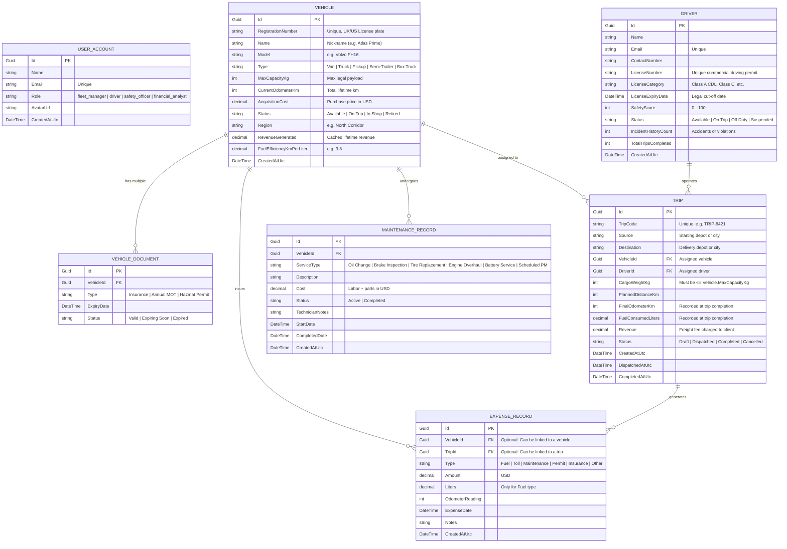

# 🚚 TransitOps: The Ultimate Guide for Junior Developers
> **A complete domain breakdown, role-based architecture guide, KPI playbook, ER diagram, and .NET EF Core backend implementation manual.**

---

## 🌟 Table of Contents
1. [The "Explain Like I'm Five" Domain Intro](#1-the-explain-like-im-five-domain-intro)
2. [The Life of a Delivery: The Real-World Pipeline](#2-the-life-of-a-delivery-the-real-world-pipeline)
3. [The 4 Roles: Who Sees What & Why? (The Secret Behind RBAC)](#3-the-4-roles-who-sees-what--why-the-secret-behind-rbac)
4. [How to Think About KPIs Like a Backend Engineer](#4-how-to-think-about-kpis-like-a-backend-engineer)
5. [Entity-Relationship (ER) Diagram (Mermaid)](#5-entity-relationship-er-diagram-mermaid)
6. [Mapping to .NET 8 and Entity Framework Core (EF Core)](#6-mapping-to-net-8-and-entity-framework-core-ef-core)
7. [Writing High-Performance EF Core KPI Queries](#7-writing-high-performance-ef-core-kpi-queries)
8. [API Route Blueprint & Business Invariants](#8-api-route-blueprint--business-invariants)

---

## 1. The "Explain Like I'm Five" Domain Intro

Imagine you run a toy store, and you own **10 toy trucks** and have **10 friend helpers** to drive them around your neighborhood delivering Lego sets. 

At first, with 1 truck and 1 friend, it's easy:
- You tell your friend: *"Take this box to Timmy's house down the street."*
- Your friend rides over, hands the box to Timmy, comes back, and you give them a cookie.

Now imagine you grow bigger. You now have:
- **50 big 18-wheel trucks** and vans.
- **70 full-time drivers**.
- **Hundreds of packages** every day going between different cities.
- **Gasoline / Diesel tanks** that cost thousands of dollars to fill up.
- **Tires that wear out** and oil that needs to be changed before the engine catches fire.
- **Government laws** saying: *"If a driver's commercial license expired, they are NOT allowed to drive on the road, period!"*

This is called **Fleet Management & Logistics**. 
**TransitOps** is the central computer system (the "mission control tower") that helps a company run this entire operation smoothly, safely, legally, and without wasting money.

---

## 2. The Life of a Delivery: The Real-World Pipeline

Every action in TransitOps follows a strict real-world pipeline:

```
[1. Asset Acquisition]  -> Buy Vehicle & Register Driver
         │
         ▼
[2. Cargo & Dispatch]   -> Create Trip: Assign Cargo Weight, Source, Destination
         │                 (Check: Cargo <= Vehicle Capacity? Driver License Valid? Vehicle Not Broken?)
         ▼
[3. Active Transit]     -> Dispatch Trip: Vehicle is "On Trip", Driver is "On Trip"
         │                 Radar tracks position & route corridor
         ▼
[4. Trip Completion]   -> Driver Turn-In: Record Final Odometer & Liters of Fuel Consumed
         │                 Calculate actual distance & fuel burned
         ▼
[5. Maintenance Check] -> Does odometer exceed service intervals?
         │                 Yes -> Vehicle status = "In Shop", create Maintenance Work Order
         ▼
[6. Financial Audit]   -> Revenue earned - (Fuel Cost + Maintenance Cost) = Profit Margin!
```

If any software bug allows a broken truck to be assigned to a trip, or an unlicensed driver to take cargo, real-world accidents and legal fines happen. **That is why the database constraints and business rules you write in .NET are super important!**

---

## 3. The 4 Roles: Who Sees What & Why? (The Secret Behind RBAC)

In software development, **RBAC** stands for **Role-Based Access Control**. 
Why don't we just show every user the exact same giant screen with all the buttons?

> **Analogy Time:** 
> When you board a commercial airplane:
> - The **Captain** needs dials for altitude, engine thrust, and weather radar.
> - The **Flight Attendant** needs seat numbers, meal trays, and emergency exits.
> - The **Mechanic** needs hydraulic pressure gauges and turbine temperature logs.
> - The **Airline Accountant** needs ticket revenue and jet fuel invoices.
>
> If you put ticket invoice forms in front of the pilot while landing, or put an engine thrust lever in front of the accountant, bad things happen! This is called **Cognitive Overload** and **Privilege Leaks**.

Here is why each role in TransitOps has a custom dashboard:

| Role | What They See | What Is Hidden | Why It's Designed This Way |
| :--- | :--- | :--- | :--- |
| **Fleet Manager** | • Live Route Radar Map<br>• Fleet Utilization %<br>• Quick Action: Create Trip<br>• Quick Action: Register Vehicle<br>• Active Dispatches Table | • Secret employee salary data<br>• Deep tax accounting | **The General**: Coordinates assets. Needs to know which trucks are moving, which are sitting idle, and who can take the next batch of cargo. |
| **Driver / Dispatcher** | • Active Dispatches Radar<br>• Pending Departure Queue<br>• "Dispatch Now" button<br>• "Complete Delivery" modal (Odometer & Fuel log) | • Company profit margins<br>• Financial ledgers<br>• Driver suspension controls | **The Boots on the Ground**: Cares about *execution*. "What cargo am I hauling?", "Where am I driving?", and "Where do I submit my odometer and gas receipt when done?" |
| **Safety Officer** | • Expired License alerts<br>• Expiring in &lt;30 days matrix<br>• "Suspend Driver" button<br>• "Send Reminder Notice" email<br>• Maintenance safety locks | • Live radar map<br>• Financial margins<br>• New trip creation | **The Guardian / Inspector**: Their only mission is safety compliance and preventing lawsuits. If a driver's license expired yesterday, they must have the power to instantly ground them. |
| **Financial Analyst** | • Total Fleet OPEX<br>• Fuel Spend vs Maintenance Breakdown<br>• Cost Per Kilometer ($/km)<br>• Trip Profitability Ledger<br>• CSV Financial Ledger Export | • Live vehicle GPS radar<br>• Dispatch / Cancel buttons<br>• Driver suspension toggles | **The Accountant**: Looks backwards and forwards at cash flow. Did Trip #TRIP-102 make money or lose money after paying for 120 liters of diesel? |

---

## 4. How to Think About KPIs Like a Backend Engineer

### What is a KPI?
**KPI** stands for **Key Performance Indicator**. Think of it like the **HUD (Heads-Up Display)** in a video game: your health bar, shield points, and ammo count. It summarizes thousands of data points into one single number so humans can make decisions in 2 seconds.

### Page-by-Page KPI Breakdown & How to Compute Them in SQL / .NET

#### A. Fleet Manager KPIs
1. **Active Dispatches**: 
   - *Meaning:* How many vehicles are moving on the highway right now?
   - *Database Logic:* `COUNT(Trips)` WHERE `Status == 'Dispatched'`
2. **Available Assets**:
   - *Meaning:* How many trucks are parked in the yard ready for work?
   - *Database Logic:* `COUNT(Vehicles)` WHERE `Status == 'Available'`
3. **Maintenance Holds**:
   - *Meaning:* Trucks currently being repaired in the shop.
   - *Database Logic:* `COUNT(Vehicles)` WHERE `Status == 'In Shop'`
4. **Fleet Utilization Rate (%)**:
   - *Meaning:* What percentage of our total vehicle investments are actively generating value vs sitting idle?
   - *Database Logic:* `(ActiveVehicles / TotalNonRetiredVehicles) * 100`

#### B. Driver / Dispatcher KPIs
1. **Pending Departure Queue**:
   - *Meaning:* Planned cargo trips waiting for a driver to grab keys and depart.
   - *Database Logic:* `COUNT(Trips)` WHERE `Status == 'Draft'`
2. **Delivered Runs**:
   - *Meaning:* Completed deliveries successfully turned in today/this month.
   - *Database Logic:* `COUNT(Trips)` WHERE `Status == 'Completed'`

#### C. Safety Officer KPIs
1. **Expired Licenses**:
   - *Meaning:* Drivers legally prohibited from driving.
   - *Database Logic:* `COUNT(Drivers)` WHERE `LicenseExpiryDate < TODAY`
2. **Expiring in &lt; 30 Days**:
   - *Meaning:* Urgent warnings before a driver gets auto-grounded.
   - *Database Logic:* `COUNT(Drivers)` WHERE `LicenseExpiryDate BETWEEN TODAY AND (TODAY + 30 Days)`
3. **Average Safety Score**:
   - *Meaning:* The overall safety health of the driver fleet (0 to 100).
   - *Database Logic:* `AVG(Drivers.SafetyScore)`

#### D. Financial Analyst KPIs
1. **Total Fleet OPEX (Operating Expenses)**:
   - *Meaning:* Every penny spent keeping the trucks rolling.
   - *Database Logic:* `SUM(MaintenanceRecords.Cost) + SUM(FuelExpenses.Cost) + SUM(OtherExpenses.Cost)`
2. **Gross Revenue**:
   - *Meaning:* How much clients paid us for hauling freight.
   - *Database Logic:* `SUM(Trips.Revenue)` WHERE `Status == 'Completed'`
3. **Net Margin (%)**:
   - *Meaning:* How much profit is kept after paying expenses.
   - *Database Logic:* `((GrossRevenue - TotalOpex) / GrossRevenue) * 100`
4. **Operating Cost per Kilometer ($/km)**:
   - *Meaning:* Efficiency metric. How much does 1 kilometer of travel cost the business?
   - *Database Logic:* `TotalOpex / SUM(Trips.PlannedDistanceKm)`

---

## 5. Entity-Relationship (ER) Diagram (Mermaid)

Below is the Entity-Relationship diagram showing all core tables, relationships, and foreign keys for TransitOps:



---

## 6. Mapping to .NET 8 and Entity Framework Core (EF Core)

Now, let's turn this into clean, production-ready C# code using **EF Core**.

### Recommended Solution Structure
```
TransitOps.sln
├── src/
│   ├── TransitOps.Domain/           # Entities, Enums, Domain Rules
│   ├── TransitOps.Application/      # DTOs, Queries, Commands (MediatR), Services
│   ├── TransitOps.Infrastructure/   # EF Core DbContext, Migrations, Repositories
│   └── TransitOps.Api/              # ASP.NET Core Web API Controllers / Minimal APIs
```

### Domain Models (`TransitOps.Domain/Entities`)

```csharp
namespace TransitOps.Domain.Enums;

public enum UserRole { FleetManager, Driver, SafetyOfficer, FinancialAnalyst }
public enum VehicleStatus { Available, OnTrip, InShop, Retired }
public enum VehicleType { Van, Truck, Pickup, SemiTrailer, BoxTruck }
public enum DriverStatus { Available, OnTrip, OffDuty, Suspended }
public enum TripStatus { Draft, Dispatched, Completed, Cancelled }
public enum MaintenanceStatus { Active, Completed }
public enum ExpenseType { Fuel, Toll, Maintenance, Permit, Insurance, Other }
```

```csharp
namespace TransitOps.Domain.Entities;

public class Vehicle
{
    public Guid Id { get; set; } = Guid.NewGuid();
    public string RegistrationNumber { get; set; } = string.Empty;
    public string Name { get; set; } = string.Empty;
    public string Model { get; set; } = string.Empty;
    public VehicleType Type { get; set; }
    public int MaxCapacityKg { get; set; }
    public int CurrentOdometerKm { get; set; }
    public decimal AcquisitionCost { get; set; }
    public VehicleStatus Status { get; set; } = VehicleStatus.Available;
    public string Region { get; set; } = "HQ Depot";
    public decimal RevenueGenerated { get; set; }
    public decimal FuelEfficiencyKmPerLiter { get; set; }
    public DateTime CreatedAtUtc { get; set; } = DateTime.UtcNow;

    // Navigation properties
    public ICollection<Trip> Trips { get; set; } = new List<Trip>();
    public ICollection<MaintenanceRecord> MaintenanceRecords { get; set; } = new List<MaintenanceRecord>();
    public ICollection<ExpenseRecord> Expenses { get; set; } = new List<ExpenseRecord>();
}

public class Driver
{
    public Guid Id { get; set; } = Guid.NewGuid();
    public string Name { get; set; } = string.Empty;
    public string Email { get; set; } = string.Empty;
    public string ContactNumber { get; set; } = string.Empty;
    public string LicenseNumber { get; set; } = string.Empty;
    public string LicenseCategory { get; set; } = string.Empty;
    public DateOnly LicenseExpiryDate { get; set; }
    public int SafetyScore { get; set; } = 100;
    public DriverStatus Status { get; set; } = DriverStatus.Available;
    public int IncidentHistoryCount { get; set; }
    public int TotalTripsCompleted { get; set; }
    public DateTime CreatedAtUtc { get; set; } = DateTime.UtcNow;

    // Navigation properties
    public ICollection<Trip> Trips { get; set; } = new List<Trip>();
}

public class Trip
{
    public Guid Id { get; set; } = Guid.NewGuid();
    public string TripCode { get; set; } = string.Empty;
    public string Source { get; set; } = string.Empty;
    public string Destination { get; set; } = string.Empty;
    
    public Guid VehicleId { get; set; }
    public Vehicle Vehicle { get; set; } = null!;

    public Guid DriverId { get; set; }
    public Driver Driver { get; set; } = null!;

    public int CargoWeightKg { get; set; }
    public int PlannedDistanceKm { get; set; }
    public int? FinalOdometerKm { get; set; }
    public decimal? FuelConsumedLiters { get; set; }
    public decimal Revenue { get; set; }
    public TripStatus Status { get; set; } = TripStatus.Draft;

    public DateTime CreatedAtUtc { get; set; } = DateTime.UtcNow;
    public DateTime? DispatchedAtUtc { get; set; }
    public DateTime? CompletedAtUtc { get; set; }
}

public class MaintenanceRecord
{
    public Guid Id { get; set; } = Guid.NewGuid();
    public Guid VehicleId { get; set; }
    public Vehicle Vehicle { get; set; } = null!;

    public string ServiceType { get; set; } = string.Empty;
    public string Description { get; set; } = string.Empty;
    public decimal Cost { get; set; }
    public MaintenanceStatus Status { get; set; } = MaintenanceStatus.Active;
    public string? TechnicianNotes { get; set; }

    public DateTime StartDate { get; set; }
    public DateTime? CompletedDate { get; set; }
}

public class ExpenseRecord
{
    public Guid Id { get; set; } = Guid.NewGuid();
    public Guid? VehicleId { get; set; }
    public Vehicle? Vehicle { get; set; }

    public Guid? TripId { get; set; }
    public Trip? Trip { get; set; }

    public ExpenseType Type { get; set; }
    public decimal Amount { get; set; }
    public decimal? Liters { get; set; }
    public int? OdometerReading { get; set; }
    public DateTime ExpenseDate { get; set; }
    public string? Notes { get; set; }
}
```

### EF Core DbContext Configuration (`TransitOpsDbContext.cs`)

```csharp
using Microsoft.EntityFrameworkCore;
using TransitOps.Domain.Entities;

namespace TransitOps.Infrastructure.Persistence;

public class TransitOpsDbContext : DbContext
{
    public TransitOpsDbContext(DbContextOptions<TransitOpsDbContext> options) : base(options) {}

    public DbSet<Vehicle> Vehicles => Set<Vehicle>();
    public DbSet<Driver> Drivers => Set<Driver>();
    public DbSet<Trip> Trips => Set<Trip>();
    public DbSet<MaintenanceRecord> MaintenanceRecords => Set<MaintenanceRecord>();
    public DbSet<ExpenseRecord> Expenses => Set<ExpenseRecord>();

    protected override void OnModelCreating(ModelBuilder modelBuilder)
    {
        base.OnModelCreating(modelBuilder);

        // VEHICLE
        modelBuilder.Entity<Vehicle>(entity =>
        {
            entity.HasKey(v => v.Id);
            entity.HasIndex(v => v.RegistrationNumber).IsUnique();
            entity.Property(v => v.RegistrationNumber).HasMaxLength(32).IsRequired();
            entity.Property(v => v.AcquisitionCost).HasPrecision(18, 2);
            entity.Property(v => v.RevenueGenerated).HasPrecision(18, 2);
            entity.Property(v => v.FuelEfficiencyKmPerLiter).HasPrecision(5, 2);
            entity.Property(v => v.Status).HasConversion<string>();
            entity.Property(v => v.Type).HasConversion<string>();
        });

        // DRIVER
        modelBuilder.Entity<Driver>(entity =>
        {
            entity.HasKey(d => d.Id);
            entity.HasIndex(d => d.Email).IsUnique();
            entity.HasIndex(d => d.LicenseNumber).IsUnique();
            entity.Property(d => d.Status).HasConversion<string>();
        });

        // TRIP
        modelBuilder.Entity<Trip>(entity =>
        {
            entity.HasKey(t => t.Id);
            entity.HasIndex(t => t.TripCode).IsUnique();
            entity.Property(t => t.Revenue).HasPrecision(18, 2);
            entity.Property(t => t.FuelConsumedLiters).HasPrecision(8, 2);
            entity.Property(t => t.Status).HasConversion<string>();

            // Restrict cascade delete so deleting a vehicle doesn't wipe audit logs
            entity.HasOne(t => t.Vehicle)
                  .WithMany(v => v.Trips)
                  .HasForeignKey(t => t.VehicleId)
                  .OnDelete(DeleteBehavior.Restrict);

            entity.HasOne(t => t.Driver)
                  .WithMany(d => d.Trips)
                  .HasForeignKey(t => t.DriverId)
                  .OnDelete(DeleteBehavior.Restrict);
        });

        // MAINTENANCE
        modelBuilder.Entity<MaintenanceRecord>(entity =>
        {
            entity.HasKey(m => m.Id);
            entity.Property(m => m.Cost).HasPrecision(18, 2);
            entity.Property(m => m.Status).HasConversion<string>();

            entity.HasOne(m => m.Vehicle)
                  .WithMany(v => v.MaintenanceRecords)
                  .HasForeignKey(m => m.VehicleId)
                  .OnDelete(DeleteBehavior.Cascade);
        });

        // EXPENSES
        modelBuilder.Entity<ExpenseRecord>(entity =>
        {
            entity.HasKey(e => e.Id);
            entity.Property(e => e.Amount).HasPrecision(18, 2);
            entity.Property(e => e.Liters).HasPrecision(8, 2);
            entity.Property(e => e.Type).HasConversion<string>();
        });
    }
}
```

---

## 7. Writing High-Performance EF Core KPI Queries

A common beginner mistake is loading thousands of records into memory with `.ToList()` and then doing `.Count()` or `.Sum()` in C#. This crashes your server when you have 100,000 trips!

Instead, **let the SQL database compute the aggregates in a single network round-trip**:

### Example: Financial Analyst Dashboard Query
```csharp
public async Task<FinancialKpiDto> GetFinancialKpisAsync(TransitOpsDbContext db, CancellationToken ct)
{
    // 1. Calculate Fuel and Maintenance in SQL
    var maintenanceCost = await db.MaintenanceRecords
        .SumAsync(m => (decimal?)m.Cost, ct) ?? 0m;

    var loggedFuelCost = await db.Expenses
        .Where(e => e.Type == ExpenseType.Fuel)
        .SumAsync(e => (decimal?)e.Amount, ct) ?? 0m;

    var otherExpenses = await db.Expenses
        .Where(e => e.Type != ExpenseType.Fuel)
        .SumAsync(e => (decimal?)e.Amount, ct) ?? 0m;

    // 2. Calculate Completed Trips Revenue & Distance in 1 query
    var tripStats = await db.Trips
        .Where(t => t.Status == TripStatus.Completed)
        .GroupBy(_ => 1)
        .Select(g => new
        {
            TotalRevenue = g.Sum(t => t.Revenue),
            TotalDistanceKm = g.Sum(t => t.PlannedDistanceKm),
            EstimatedFuelSpend = g.Sum(t => (t.FuelConsumedLiters ?? (t.PlannedDistanceKm * 0.18m)) * 1.45m)
        })
        .FirstOrDefaultAsync(ct);

    decimal grossRevenue = tripStats?.TotalRevenue ?? 0m;
    decimal fuelCost = Math.Max(loggedFuelCost, tripStats?.EstimatedFuelSpend ?? 0m);
    decimal totalOpex = maintenanceCost + fuelCost + otherExpenses;
    decimal netMargin = grossRevenue > 0 ? ((grossRevenue - totalOpex) / grossRevenue) * 100m : 0m;
    decimal costPerKm = (tripStats?.TotalDistanceKm > 0) ? (totalOpex / tripStats.TotalDistanceKm) : 0m;

    return new FinancialKpiDto(
        TotalOpex: totalOpex,
        FuelSpend: fuelCost,
        MaintenanceSpend: maintenanceCost,
        GrossRevenue: grossRevenue,
        NetMarginPercentage: Math.Round(netMargin, 1),
        CostPerKm: Math.Round(costPerKm, 2)
    );
}
```

### Example: Safety Officer Compliance Query
```csharp
public async Task<SafetyKpiDto> GetSafetyKpisAsync(TransitOpsDbContext db, CancellationToken ct)
{
    var today = DateOnly.FromDateTime(DateTime.UtcNow);
    var warningThreshold = today.AddDays(30);

    var driverStats = await db.Drivers
        .GroupBy(_ => 1)
        .Select(g => new
        {
            ExpiredCount = g.Count(d => d.LicenseExpiryDate < today),
            ExpiringSoonCount = g.Count(d => d.LicenseExpiryDate >= today && d.LicenseExpiryDate <= warningThreshold),
            SuspendedCount = g.Count(d => d.Status == DriverStatus.Suspended),
            CompliantCount = g.Count(d => d.LicenseExpiryDate >= today && d.Status != DriverStatus.Suspended),
            AverageSafetyScore = g.Average(d => (double?)d.SafetyScore) ?? 100.0
        })
        .FirstOrDefaultAsync(ct);

    var activeWorkOrders = await db.MaintenanceRecords
        .CountAsync(m => m.Status == MaintenanceStatus.Active, ct);

    return new SafetyKpiDto(
        ExpiredLicenses: driverStats?.ExpiredCount ?? 0,
        ExpiringSoon: driverStats?.ExpiringSoonCount ?? 0,
        SuspendedDrivers: driverStats?.SuspendedCount ?? 0,
        CompliantDrivers: driverStats?.CompliantCount ?? 0,
        InShopInspectionLocks: activeWorkOrders,
        AverageSafetyScore: Math.Round(driverStats?.AverageSafetyScore ?? 100.0, 0)
    );
}
```

---

## 8. API Route Blueprint & Business Invariants

When implementing ASP.NET Core endpoints, enforce these **Golden Business Invariants**:

### Rule 1: Never Overload Cargo
```csharp
// POST /api/trips
if (request.CargoWeightKg > vehicle.MaxCapacityKg)
{
    return Results.BadRequest(new {
        Error = $"Cargo weight ({request.CargoWeightKg} kg) exceeds vehicle max payload capacity ({vehicle.MaxCapacityKg} kg)."
    });
}
```

### Rule 2: Ground Expired or Suspended Drivers
```csharp
// POST /api/trips/dispatch
if (driver.Status == DriverStatus.Suspended || driver.LicenseExpiryDate < DateOnly.FromDateTime(DateTime.UtcNow))
{
    return Results.UnprocessableEntity(new {
        Error = "Driver is legally grounded due to an expired commercial license or active safety suspension."
    });
}
```

### Rule 3: Atomic Trip Dispatching & Completion
When a trip is dispatched:
1. `Trip.Status = TripStatus.Dispatched`
2. `Vehicle.Status = VehicleStatus.OnTrip`
3. `Driver.Status = DriverStatus.OnTrip`
*(Wrap in an EF Core transaction `using var tx = await db.Database.BeginTransactionAsync()` so either all 3 update or none do!)*

When a trip completes:
1. `Trip.Status = TripStatus.Completed`
2. `Trip.FinalOdometerKm = request.FinalOdometer`
3. `Trip.FuelConsumedLiters = request.FuelConsumed`
4. `Vehicle.CurrentOdometerKm = request.FinalOdometer`
5. `Vehicle.Status = VehicleStatus.Available`
6. `Driver.Status = DriverStatus.Available`
7. `Driver.TotalTripsCompleted += 1`
8. Check if odometer triggered a scheduled service interval -> if so, switch vehicle to `InShop`!

---

## 💡 Summary Checklist for the .NET Backend Team
- [x] **Entities Created:** Vehicle, Driver, Trip, MaintenanceRecord, ExpenseRecord, UserAccount.
- [x] **Relational Rules Set:** Unique indices on registration number, license number, and trip codes. Cascade delete restricted on trips to preserve audit history.
- [x] **Role Access Policies Configured:** Use ASP.NET Core Authorization Policies (`[Authorize(Roles = "FleetManager,Driver")]`).
- [x] **Aggregations Optimized:** KPI queries grouped in SQL to prevent memory leaks and maintain sub-50ms response times.
- [x] **Status State Machine Respected:** Vehicles and drivers cleanly transition states (`Available` -> `OnTrip` -> `Available` / `InShop`).
