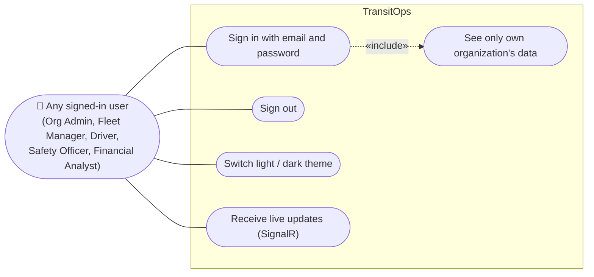
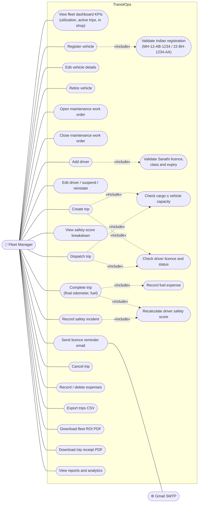
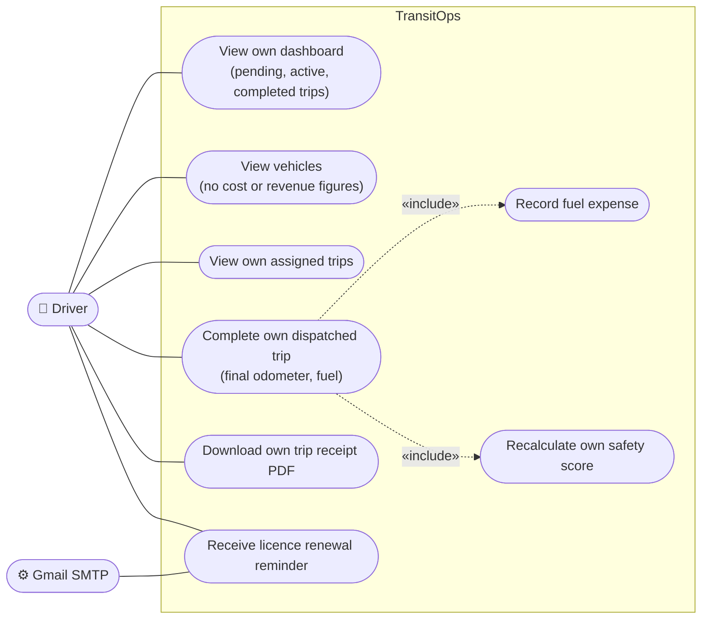
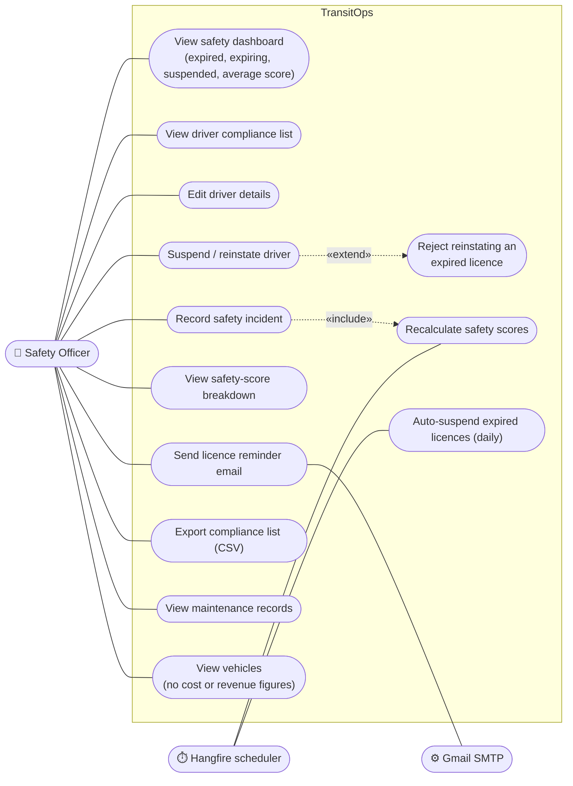
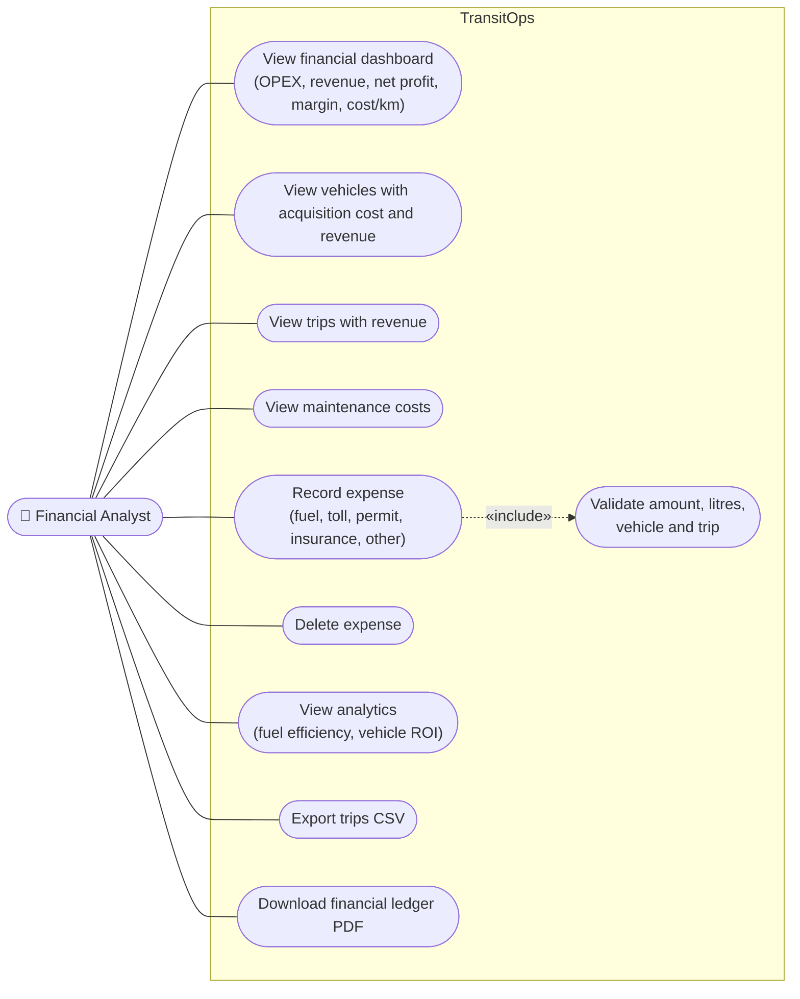
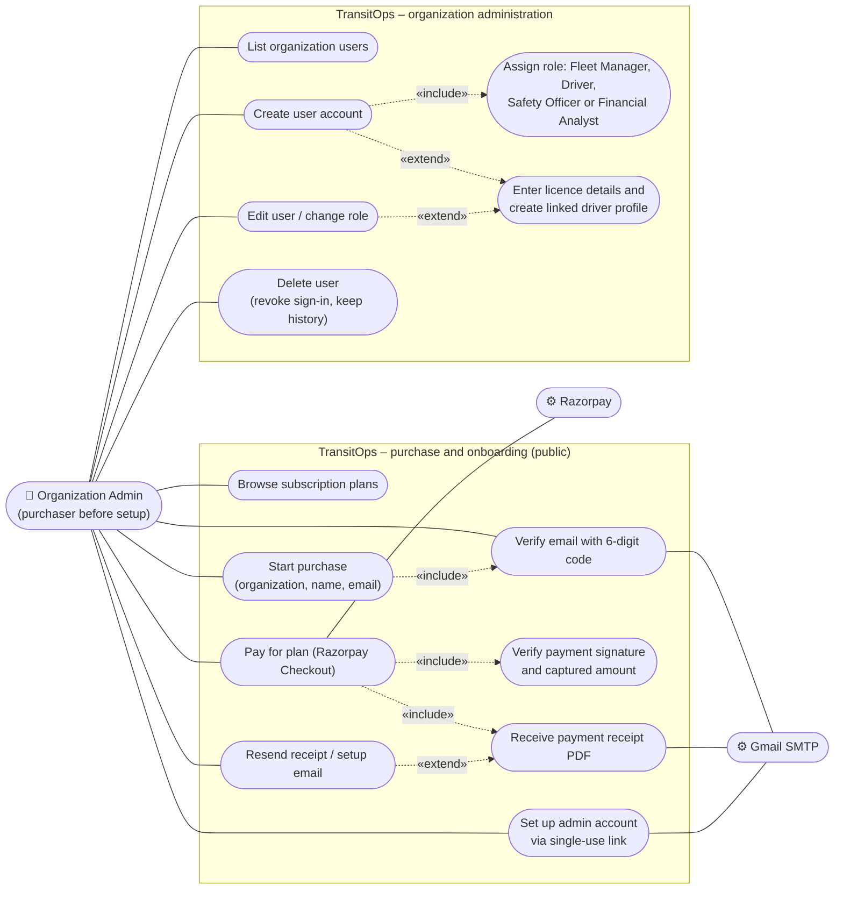

# 1. Use Case Diagrams

One diagram per actor, taken from the `[Authorize(Roles = ...)]` attributes on the API controllers and the role
dashboards in the frontend. Every operational actor also signs in and out and receives live SignalR updates;
those common use cases are shown once, in 1.0.
There is **no separate Dispatcher role**: creating, dispatching and cancelling trips is a Fleet Manager action.

Notation: `«include»` means the use case always performs the included one; `«extend»` means it happens only
in some cases. System actors (Razorpay, Gmail SMTP, Hangfire scheduler) are shown on the right.

## 1.0 Common to every signed-in user

## 1.1 Fleet Manager

## 1.2 Driver

A Driver cannot create, dispatch or cancel trips, and cannot see other drivers' trips; the API checks the
linked driver profile on every trip request.

## 1.3 Safety Officer

## 1.4 Financial Analyst

## 1.5 Organization Admin

The Organization Admin is the customer who buys TransitOps. They first purchase a plan, then manage their
organization's user accounts. They do not run day-to-day fleet operations.

The admin role can only be created by this purchase flow. An Organization Admin cannot create another
Organization Admin, and nobody can promote themselves to one.

## 1.6 Permission matrix (summary)

| Resource / action | Org Admin | Fleet Manager | Driver | Safety Officer | Financial Analyst |
|---|:-:|:-:|:-:|:-:|:-:|
| Vehicles – view | – | ✅ | ✅ (no financials) | ✅ (no financials) | ✅ |
| Vehicles – create / update / retire | – | ✅ | – | – | – |
| Drivers – view | – | ✅ | – | ✅ | – |
| Drivers – create | – | ✅ | – | – | – |
| Drivers – update / suspend / remind | – | ✅ | – | ✅ | – |
| Drivers – record incident / score breakdown | – | ✅ | – | ✅ | – |
| Trips – view | – | ✅ | own only | – | ✅ |
| Trips – create / dispatch / cancel | – | ✅ | – | – | – |
| Trips – complete | – | ✅ | own only | – | – |
| Maintenance – view | – | ✅ | – | ✅ | ✅ |
| Maintenance – create / close | – | ✅ | – | – | – |
| Expenses – view / create / delete | – | ✅ | – | – | ✅ |
| CSV trip export | – | ✅ | – | – | ✅ |
| Ledger PDF | – | – | – | – | ✅ |
| Fleet ROI PDF | – | ✅ | – | – | – |
| Trip receipt PDF | – | ✅ | own only | – | – |
| Organization users admin | ✅ | – | – | – | – |
