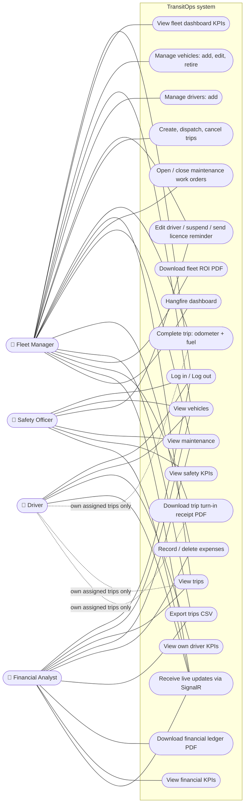
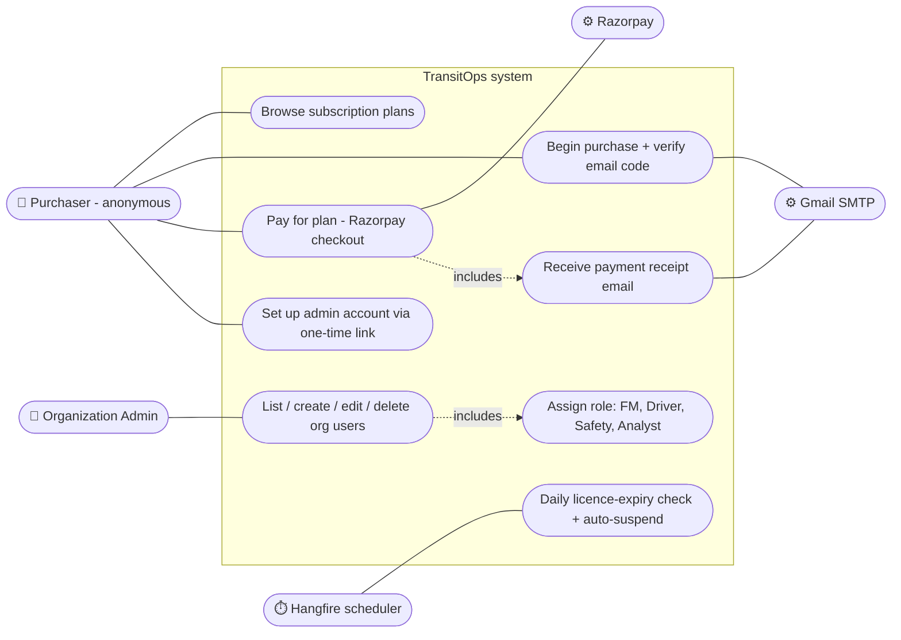

# 1. Use Case Diagrams

Actors and what each one can do, taken from the `[Authorize(Roles = ...)]` attributes on the API controllers.
There is **no separate Dispatcher role**: creating, dispatching and cancelling trips is a Fleet Manager action.

## 1.1 Operational roles

## 1.2 SaaS purchase and administration

## 1.3 Permission matrix (summary)

| Resource / action | Org Admin | Fleet Manager | Driver | Safety Officer | Financial Analyst |
|---|:-:|:-:|:-:|:-:|:-:|
| Vehicles – view | – | ✅ | ✅ (no financials) | ✅ (no financials) | ✅ |
| Vehicles – create / update / retire | – | ✅ | – | – | – |
| Drivers – view | – | ✅ | – | ✅ | – |
| Drivers – create | – | ✅ | – | – | – |
| Drivers – update / suspend / remind | – | ✅ | – | ✅ | – |
| Trips – view | – | ✅ | own only | – | ✅ |
| Trips – create / dispatch / cancel | – | ✅ | – | – | – |
| Trips – complete | – | ✅ | own only | – | – |
| Maintenance – view | – | ✅ | – | ✅ | ✅ |
| Maintenance – create / close | – | ✅ | – | – | – |
| Expenses – view / create / delete | – | ✅ | – | – | ✅ |
| CSV trip export | – | ✅ | – | – | ✅ |
| Ledger PDF | – | – | – | – | ✅ |
| Fleet ROI PDF | – | ✅ | – | – | – |
| Trip receipt PDF | – | ✅ | own only | – | – |
| Org users admin | ✅ | – | – | – | – |
