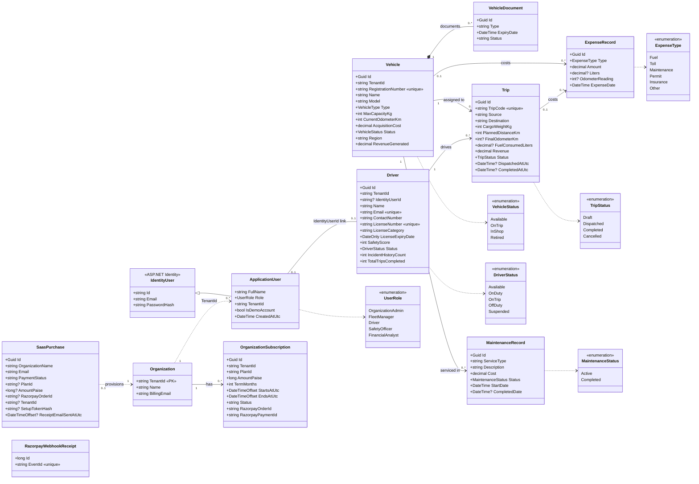
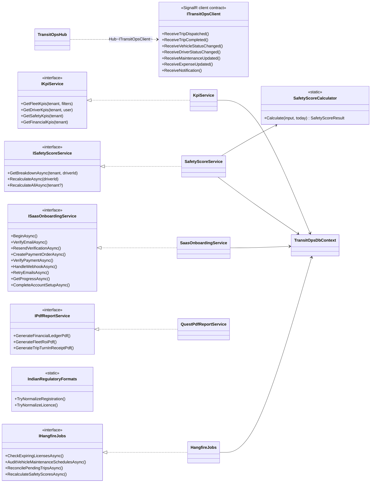

# 3. Class Diagram (Domain model)

Based on `backend/TransitOps.Domain/Entities/Entities.cs` and `Enums/Enums.cs`.
Every operational entity carries a `TenantId`, so organizations are fully isolated.

## 3.1 Service layer

