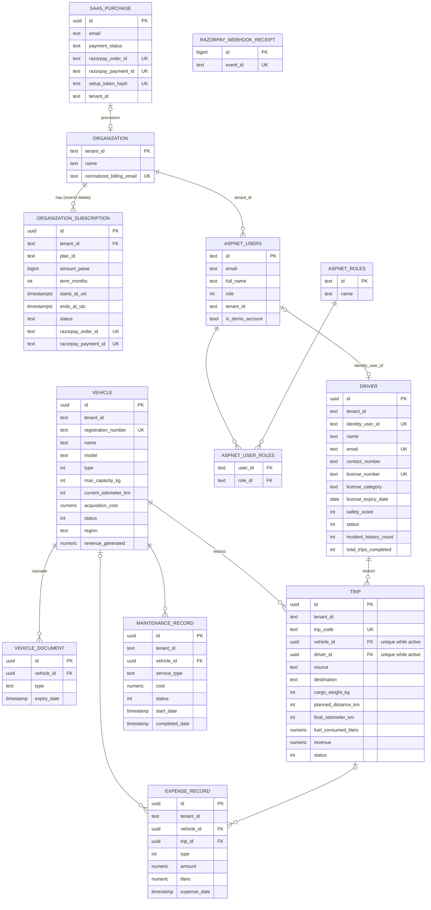

# 4. Entity-Relationship Diagram (PostgreSQL)

Based on `TransitOpsDbContext.cs`. Deletes from Vehicle/Driver to Trip are `Restrict`, so history is never cascaded away.
Vehicles are "deleted" by setting status `Retired`.

