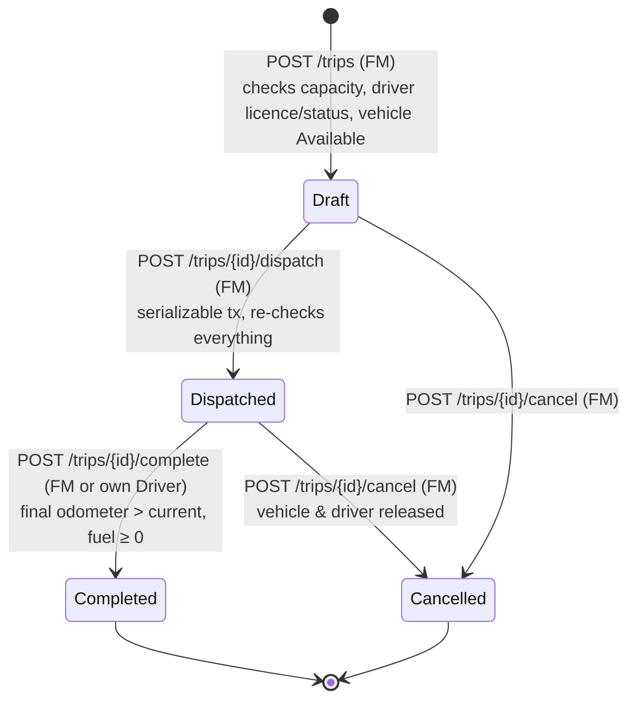
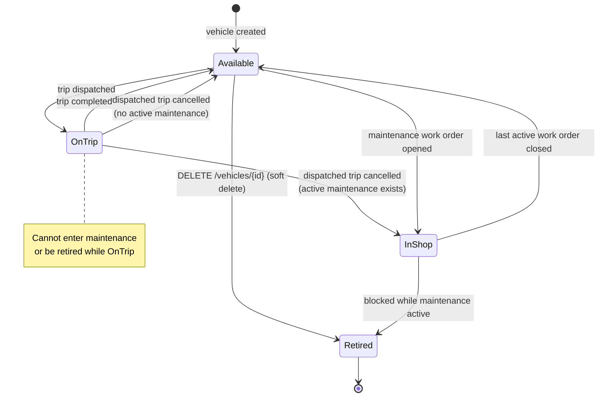
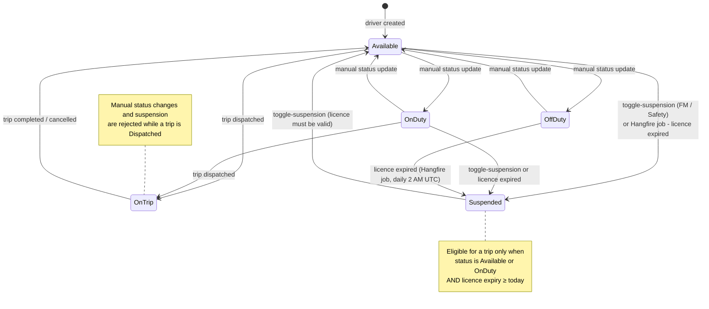
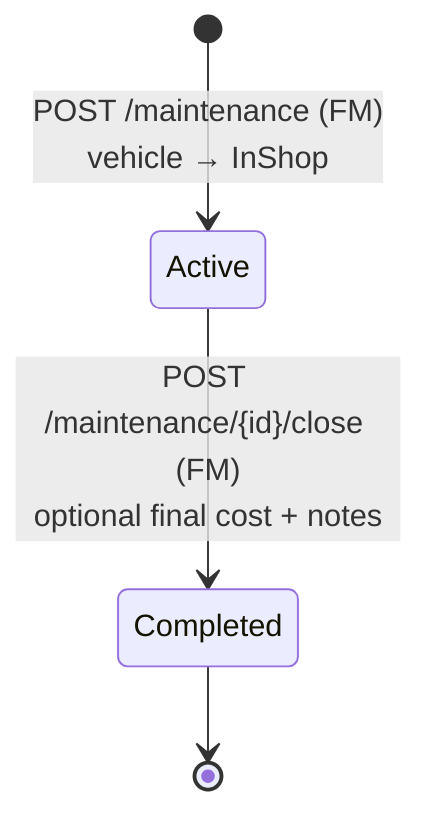
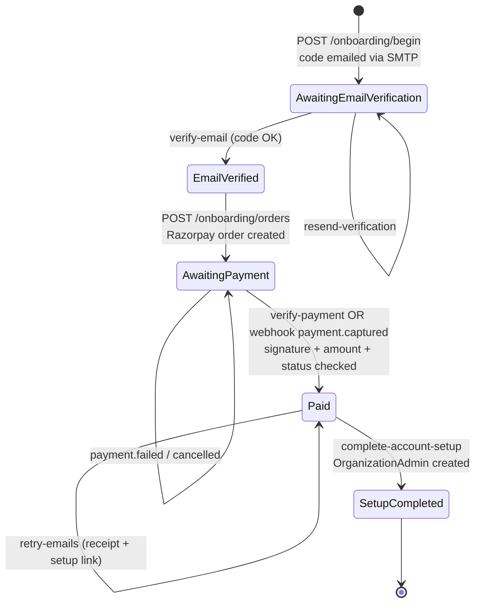

# 5. State Machine Diagrams

These are the status transitions the API actually performs (`TripsController`, `MaintenanceController`,
`VehiclesController`, `DriversController`, `HangfireJobs`, `SaasOnboardingService`).

## 5.1 Trip lifecycle

## 5.2 Vehicle status

## 5.3 Driver status

## 5.4 Maintenance work order

## 5.5 SaaS purchase (onboarding)

