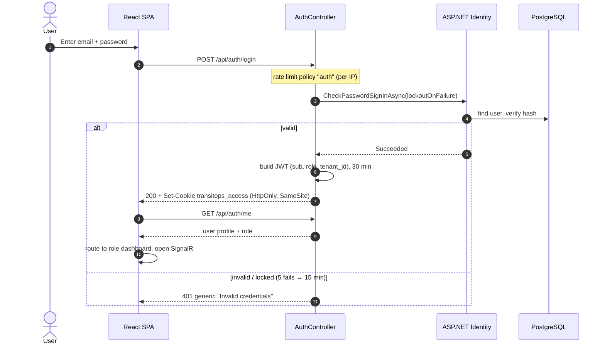
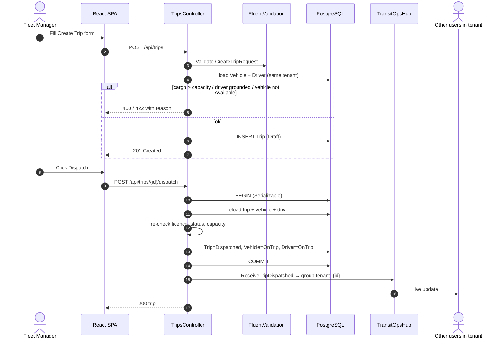
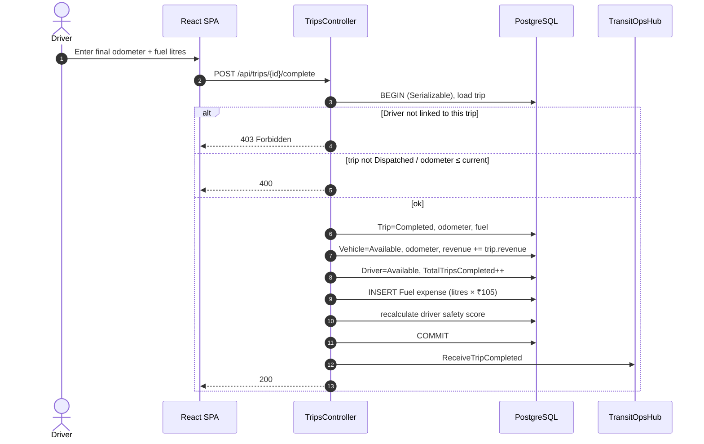
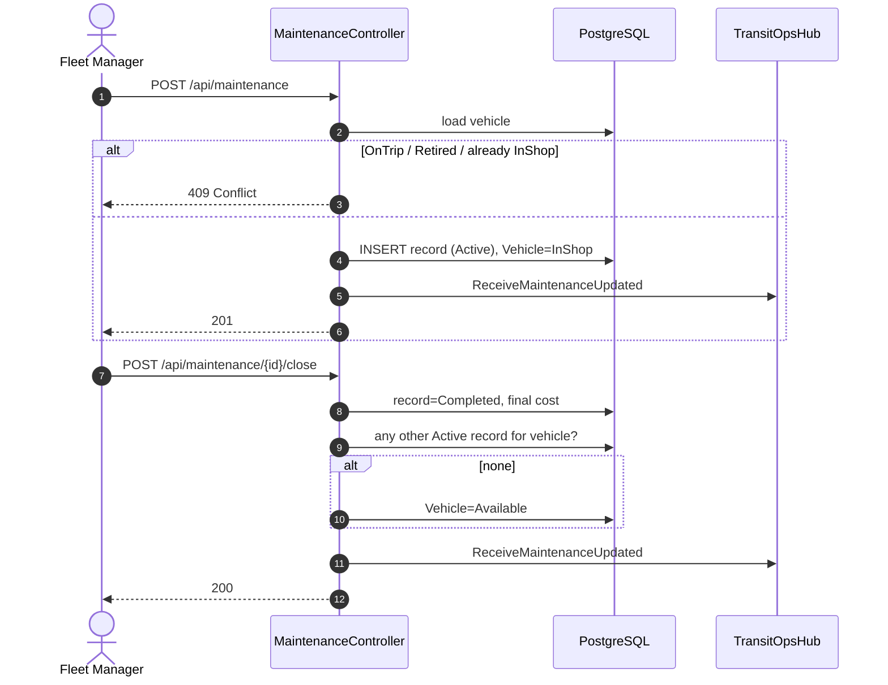
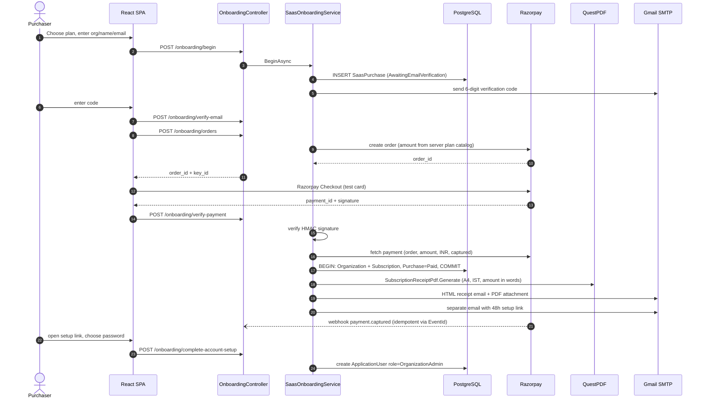
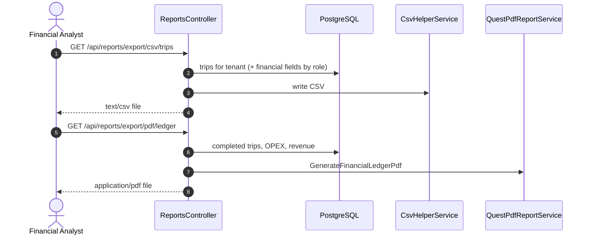
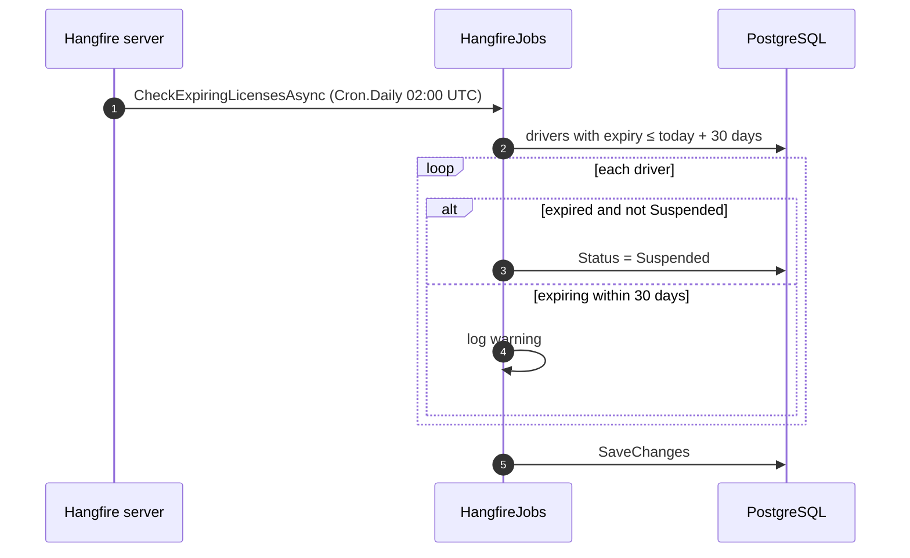

# 6. Sequence Diagrams

## 6.1 Login (JWT in HttpOnly cookie)

## 6.2 Create and dispatch a trip

## 6.3 Complete a trip (Driver or Fleet Manager)

## 6.4 Maintenance work order

## 6.5 SaaS purchase → payment → receipt email → admin setup

## 6.6 Report export (CSV / PDF)

## 6.7 Background job: daily licence-expiry check

